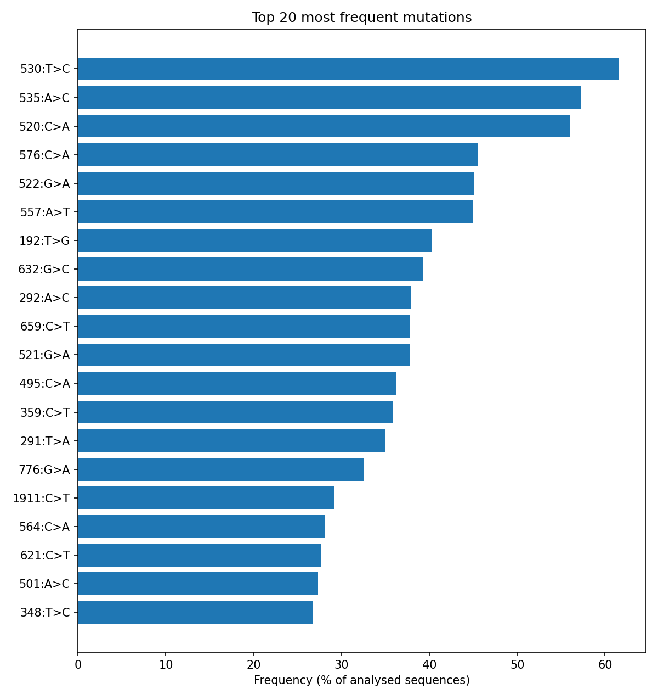
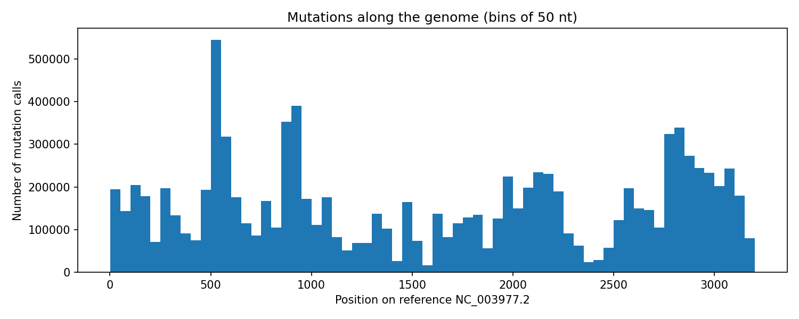

# 1. Question

Hepatitis B is a chronic liver infection caused by the hepatitis B virus (HBV),
a small (≈ 3.2 kb) circular DNA virus whose genome varies between patients and
genotypes. Thousands of HBV sequences are deposited in public databases.
**Research question: which nucleotide positions of the HBV genome are most
frequently mutated, relative to the reference genome NC_003977.2, among the HBV
sequences publicly available in NCBI Virus?** The goal is a reproducible
pipeline that answers this question automatically from the raw data, and can
be re-run on each new NCBI snapshot.

# 2. Data

* **Source:** NCBI Virus, downloaded through the NCBI Datasets v2 API
  (`virus/genome/download`) for taxon **10404** (*Hepadnaviridae*); public, no
  personal data. Full provenance in `SOURCES.md`.
* **Reference snapshot:** retrieved on **14 November 2026**; ZIP of 32.9 MB,
  extracted package of **405.7 MiB** (`genomic.fna` 146.7 MB + metadata
  `data_report.jsonl` 278.6 MB), i.e. within the required 100 MB – 1 GB.
* **Content:** 142,288 nucleotide records, 132,005,421 nt. The shell profile of
  `run.sh` shows that the collection is dominated by short partial sequences:
  56,152 records are shorter than 500 nt and only 19,098 are ≥ 3,000 nt; header
  labels are mostly "partial cds" (82,365) versus 13,830 "complete genome".
* **Integrity:** NCBI's `md5sum.txt` and our SHA-256 lists are verified at
  every run (`md5sum -c`, `sha256sum -c`); the raw package is then made read-only.
* **Reference genome:** RefSeq **NC_003977.2**, HBV strain ayw, 3,182 nt.

# 3. Method and definition of the pattern

`run.sh` executes ten stages without manual intervention:

1. **Download** (Python `urllib`, cached, retries) and normalisation to
   `sequences.fasta` + `metadata.csv`; size check 100 MB – 1 GB.
2. **Integrity** verification and read-only protection of the raw data.
3. **Shell profiling** with pipes (`grep | cut | sed | sort | uniq`, `awk`):
   record count, duplicate accessions, length bins, header labels, base composition.
4. **Preprocessing** (`preprocess.py`): keep records whose NCBI taxonomy is HBV
   (taxon 10407 or HBV lineage), validate IUPAC symbols, audit duplicates.
   Result: **140,889 HBV records** kept, 1,399 non-HBV hepadnaviruses excluded,
   0 rejected; 127,420 partial / 13,469 complete.
5. **Alignment and mutation calling** (`analyze_mutations.py`): MAFFT
   `--6merpair --addfragments` adds each sequence to the reference
   NC_003977.2 (batches of 500). A sequence is analysed if it has ≥ 100 nt,
   ≥ 80 aligned A/C/G/T bases and ≥ 70 % identity to the reference. Calls are
   made in 1-based reference coordinates; unobserved ends of partial sequences
   are *not* called deletions; IUPAC ambiguity codes give *uncertain* calls.
6. **Statistics and figures** (`statistics.py`, pandas/matplotlib): streamed
   aggregation of the mutation table, CSV/JSON outputs and three figures.
7. **Shell cross-check:** the top mutations are recounted by a pipe
   (`cut | grep | awk | sort | uniq -c | sort | awk`) and compared with Python.
8. **Dashboard** (HTML), 9. **SHA-256 of all results**, 10. **dated tar.gz archive**.

**Pattern searched.** A *mutation* is a **definitive** difference between a
sample and NC_003977.2, written `position:REF>ALT`: a substitution (e.g.
`530:T>C`), a deletion (`1764:A>-`) or an insertion between two reference
positions (`2857^2858:->TTG…`). The pattern of interest is a **recurrent
mutation**, measured by its frequency

$$f(m) = \frac{\text{number of analysed sequences carrying } m}{\text{number of analysed sequences}}$$

computed on accessions (denominator 128,406). Uncertain (ambiguous-base) calls
are kept in the event table but excluded from frequencies.

# 4. Results

**Alignment.** 130,871 HBV records passed the length filter; **128,406 were
analysed** and 12,482 skipped (10,017 too short, 2,464 identity < 70 %, 1 with
too few aligned bases). The run produced **10,567,649 mutation events**:
9,097,676 substitutions, 976,187 deletions, 24,199 insertions (all
definitive: 10,098,062) and 469,587 uncertain ambiguous-base calls.
128,066 of the analysed sequences differ from the reference at least once.

**Recurrent mutations.** There are **16,235 distinct confirmed mutations**.
Most are rare, but 907 are carried by ≥ 1 % of the analysed sequences, 457 by
≥ 5 % and 47 by ≥ 20 %. The most frequent ones are substitutions:

| Rank | Mutation | Sequences | Frequency |   | Rank | Mutation | Sequences | Frequency |
|---:|---|---:|---:|---|---:|---|---:|---:|
| 1 | 530:T>C | 79,029 | 61.5 % | | 6 | 557:A>T | 57,651 | 44.9 % |
| 2 | 535:A>C | 73,512 | 57.2 % | | 7 | 192:T>G | 51,675 | 40.2 % |
| 3 | 520:C>A | 71,874 | 56.0 % | | 8 | 632:G>C | 50,401 | 39.3 % |
| 4 | 576:C>A | 58,525 | 45.6 % | | 9 | 292:A>C | 48,596 | 37.8 % |
| 5 | 522:G>A | 57,966 | 45.1 % | | 10 | 659:C>T | 48,566 | 37.8 % |

Three mutations are present in **more than half** of the analysed sequences:
at those positions the reference base is the *minority* base of the dataset.
Their high frequency therefore reflects the difference between the reference
strain and the strains that dominate NCBI, not necessarily a mutation acquired
during disease. 19 of the 20 most frequent mutations lie between positions 192
and 776; the only exception is `1911:C>T` (29.2 %).

{width=48%}

{width=88%}

**Along the genome** (Figure 2) mutation calls are not uniform: the densest bin
is 500–550 (≈ 545,000 calls), with other peaks around 850–950 and 2,750–2,850,
and minima near 1,550 and 2,350–2,450. Because 90 % of the records are partial,
this profile mixes true variability with the number of sequences covering each
region (coverage is not normalised).

**Verification.** The shell recount of the top 20 mutations gives exactly the
same numbers as `statistics.py` (`results/shell/crosscheck_top_mutations.tsv`).
Re-running `./run.sh -s` on the same snapshot on a clean Ubuntu 24.04 machine
(MAFFT 7.505 instead of 7.525) reproduced **exactly** the same counts: 140,889
HBV records, 128,406 analysed sequences, 10,567,649 events with the same
breakdown by type; all result files, including the 10-million-row mutation
table, are byte-identical (same SHA-256). A fresh download on 20 November 2026 (142,376 records,
406.1 MB) gave 128,414 analysed sequences and 10,567,429 events, and the same
top mutations (the counts change slightly as the database grows). The automated test suite (110
tests) passes on the same clean machine.

# 5. Limitations

* **Partial and redundant data.** ≈ 90 % of records are partial genomes, so
  each frequency has a different effective denominator per region; identical
  sequences submitted under different accessions (31,290 extra copies in
  11,913 groups) are all counted.
* **Single reference.** HBV has at least eight genotypes (A–H); with one
  reference (strain ayw), genotype-specific bases appear as frequent
  "mutations". NCBI metadata has no reliable genotype field, so no stratified
  analysis is made.
* **Alignment heuristics.** Thresholds (100 nt, 80 bases, 70 % identity) are
  empirical; input orientation is kept (no reverse-complement search) and the
  circular genome is treated as linear, so origin-spanning or reversed records
  may be skipped or misaligned.
* **No biological annotation.** Positions are NC_003977.2 coordinates; they are
  not converted to the classical HBV numbering, genes, codons or amino acids,
  so known clinical mutations cannot be identified directly and no clinical
  conclusion is drawn.
* **Moving dataset.** NCBI Virus grows continuously; a new download gives
  different counts (all provenance is logged), and the reported numbers apply
  to the 14 November 2026 snapshot.

**Conclusion.** The pipeline answers the question reproducibly: from 142,288
public records it identifies 16,235 confirmed mutations, of which a small set
of substitutions concentrated in the first 800 positions of NC_003977.2 is
shared by 27–62 % of the sequences. A genotype-stratified analysis and gene
annotation would be the next steps to separate genotype markers from
disease-associated mutations.
